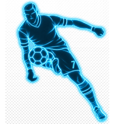

# blue41 PES2021 Mod Studio — v0.4.1 Beta

> **Beta:** it works, but bugs can still happen and some pages are still placeholders. Every change the app makes is backed up and can be undone (see "Change log" below). Found a bug or have an idea? Write to [blue41management@gmail.com](mailto:blue41management@gmail.com)

Website: <https://limadiogenes.github.io/blue41_PES2021_MOD_STUDIO/>

## Requirements
- Windows 10 or 11 (64-bit)
- eFootball PES 2021 with Sider 7 (works with patches that use Sider: built and tested on SP Football Life 2026 and 2027;
  vanilla PES 2021 is not tested yet)

## Getting started
- Unzip the folder anywhere. No installer: settings and backups stay inside this folder.
- Run `blue41.ModStudio.exe`.
- Home: the app finds your games (PES 2021 / FL26 / FL27), their Sider and save folders. Switch game on Home or under
  the logo; each game keeps its own folders. If one is missing, click its dimmed button or "Choose…" and pick it.
- Language: English, Español, Português (Brasil) (Settings).
- Notices: what each page needs (Sider options, ball server, modules) with download links; close any notice, it
  stays listed on the Notices page.
- First start: you can install the blue41 modules you want (you can also do it later).
- Changes to Sider (modules, settings, chants, boots) are loaded when the game starts: restart the game to see them.
- Anything that writes asks first. Slow tasks show a progress window.

## Sider
- Settings: every sider.ini option explained in plain words, with switches, key pickers, font list and colour picker.
- Modules / Content roots: switch Lua modules and livecpk folders on or off and change their order.
- Text: see the whole sider.ini with a before/after comparison of your changes.

## blue41 modules — Chants
- Included sets: Liverpool FC, SC Corinthians and Brazil, one click each.
- "+ Add team": pick a team, then drop MP3 or WAV files (or a folder) on it, or use "Add songs…".
- Songs are converted in the background and matched to the game's chant loudness. A different song plays each time.
- Home / away volume on the Chants page, or in game in the Sider overlay (ChantRotator_blue41): [2]/[3] home, [4]/[5] away.
- Long songs play in full on bigger tracks borrowed from teams not in the match, and get a shortened version for smaller tracks.
- "Trim…" on a song: listen from any point on its timeline, cut noise at the start or end, speed it up by up to 6 % (same pitch).

## Become a Legend
Close the game (or stay outside Become a Legend, in the main menu) before saving, then load the career.
- **Team:** shirt numbers of your career's teams (arrows or typing; a number another player wears shows in red
  with a "Swap" button), "Default numbers" from your patch. Captain tab: the captain the Captain & set pieces
  module keeps in the game (Sider overlay -> BALCaptain_blue41, [6] applies at once). Set pieces tab: the free-kick, corner and penalty takers the same module keeps
  in the game (long FK, short FK, second FK taker, left / right corner, penalty).
- **National numbers:** give national teams your numbers after each call-up.
  - Templates: drag the number cards onto the positions (1–23); P1 goes to the coach's first choice.
  - Star players: they always wear their number (two stars of the same country can't share one).
  - Your player: same as at your club, or a number you choose.
  - Apply to save, or install the in-game module (it does it before every international match).
- **Captain & set pieces:** the module behind the Captain tab; it needs up to about half a minute after a
  career loads (or [6] in the Sider overlay).
- **Transfers:** move a player to another club, the way the game does it. Only during the transfer windows
  (July–August, January) unless you tick "do it anyway". History: this window's transfer news.
- **My player:** every value of your own player as the game keeps it in your career save.
- **Move a career (experimental):** continue a Become a Legend or Master League career from another game you have
  installed (e.g. FL26 → FL27); written as a new save, the original stays.

## Cheats (Become a Legend)
- **No Injuries:** in-match injuries off (ON at every game start; overlay -> NoInjuries_blue41 -> [2] to switch).
- **Fitness & form lock:** keeps your own player's stamina, form and "days out" where you set them (module; up to
  about half a minute after a career loads, or [3] in the Sider overlay).
- **Full team control:** control the whole team, Cursor Change in the pause menu and the full Game Plan (formation,
  tactics, substitutions) in Become a Legend matches (module; overlay -> BALFullControl_blue41).

## Boots & gloves
- Every boot and glove your game uses, with its picture, its place in the game's menu and how many players wear it.
- Click one to open it: pictures, the names shown in the game's menu, move it in the menu, swap it with another,
  give it to players (search by name or team), export / import its textures, menu picture from any image.
- Click the player count for the list of players: tick some and change them to another one.
- Drag a tile onto another to swap their places (the players stay with the place — for a new colourway — or keep
  their boots); drag the player count onto another tile to move all those players.
- Import pack: zip, 7z, rar or a folder. Review what's new, what would replace yours and what you already
  have; new items replace yours by line (menu place and players move with them); optionally delete the replaced
  ones and use the pack's player list.
- Missing: players whose boot or glove isn't installed (no feet / hands in game): random, one for all, or one by one.
- Select to delete (tick tiles) or Remove unused, both to the Recycle Bin. Filters by brand and an order for the
  items outside the menu.
- Your changes live in the studio's own Sider folder (ModStudio-Gear, first in Sider's order) and survive patch
  updates; if your patch's files change, the page offers to rebuild on them. "Undo" (top right) reverts the last change.

## Kits
- Works with the kit server your patch ships (FL27: common\kits.lua, FL26: kserv.lua).
- Team kits: every kit of a team, drag to change the order, take kits out of the game or put them back, copy a kit,
  export / replace each texture as PNG, remove a whole team.
- Add a team: a team of your game without kits gets the blue41 template set (home, away, two goalkeeper kits) or a copy
  of another team's kits.
- Numbers & letters: back, chest and shorts numbers and name letters in any font, colour, outline and width.
- Colours & settings: kit colours (detect, picker, pick from the picture), collar, shirt model, name and number position
  and size, name / chest / shorts numbers on or off.

## Balls
- The balls your ball server (BallServer, or FL27's own omb) gives each competition: drag and drop, sets, finals /
  winter / hi-vis balls, winter weeks; competitions with the same name and balls shown as one card.
- Ball page: pictures, rename everywhere, menu picture from an image, texture export / import. Import ball packs.

## Move from another game
- Bring your mods from another installed game (e.g. FL26 → FL27): content roots, Lua modules with their content,
  add-on game files (commentary packs, face packs). Kits, balls and stadiums can go into FL27's own modules.
- Nothing is overwritten, the other game stays as it is, and every copy can be undone in the Change log.

## Settings
- Theme, language, app folders, and how many save backups to keep (each backup is a full copy of the save).

## Change log (bottom of the sidebar)
- Every change the app made to your game, Sider or saves is listed here.
- "Undo" puts the files back exactly as they were.

## Sider overlay tip
- Open the overlay with Sider's overlay key (Space by default) and press [1] to switch between modules.

## Antivirus and Windows warnings
- The app is new and not code-signed, so Windows may show "Windows protected your PC": click "More info" -> "Run anyway".
- The app never touches another program's memory. The Become a Legend modules run inside the game through Sider, like
  every other Sider module. If your antivirus ever removes the game, Sider or save files, look in its quarantine,
  restore them and add the game folder as an exception. Please tell us which antivirus it was.

## Support the project
- The studio is free and made by one independent developer.
- Patreon: <https://www.patreon.com/blue41Studio>
- Buy Me a Coffee: <https://buymeacoffee.com/blue41studio>

## Contact
- [blue41management@gmail.com](mailto:blue41management@gmail.com)

## License
Freeware, all rights reserved - see [LICENSE.txt](LICENSE.txt). Please share the website link instead of re-uploading the app.
Not affiliated with or endorsed by KONAMI. eFootball and PES are trademarks of KONAMI. The app ships no game files.
Sider is a separate tool by its own author.
