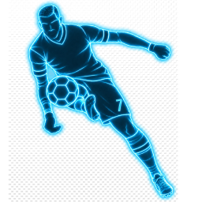

# blue41 PES2021 Mod Studio — v0.2.0 Beta

> **Beta:** it works, but bugs can still happen and some pages are still placeholders. Every change the app makes is backed up and can be undone (see "Change log" below). Found a bug or have an idea? Write to [blue41management@gmail.com](mailto:blue41management@gmail.com)

Website: <https://limadiogenes.github.io/blue41_PES2021_MOD_STUDIO/>

## Requirements
- Windows 10 or 11 (64-bit)
- eFootball PES 2021 with Sider 7 (works with patches that use Sider, e.g. SP Football Life)

## Getting started
- Unzip the folder anywhere. No installer: settings and backups stay inside this folder.
- Run `blue41.ModStudio.exe`.
- Home: the app finds your game, Sider and save folders. If one is missing, click "Choose…" and pick it.
- First start: you can install the blue41 modules you want (you can also do it later).
- Changes to Sider (modules, settings, chants, boots) are loaded when the game starts: restart the game to see them.
- Anything that writes asks first. Slow tasks show a progress window.

## Sider
- Settings: every sider.ini option explained in plain words, with switches, key pickers, font list and colour picker.
- Modules / Content roots: switch Lua modules and livecpk folders on or off and change their order.
- Text: see the whole sider.ini with a before/after comparison of your changes.

## blue41 modules — Chants
- Included sets: click "+ Liverpool FC" or "+ SC Corinthians" to add them in one click.
- "+ Add team": pick a team, then drop MP3 or WAV files (or a folder) on it, or use "Add songs…".
- Songs are converted in the background and matched to the game's chant loudness. A different song plays each time.
- Home / away volume on the Chants page, or in game in the Sider overlay (ChantRotator_blue41): [2]/[3] home, [4]/[5] away.

## Become a Legend
Close the game (or stay outside Become a Legend, in the main menu) before saving, then load the career.
- **BAL editor:** shirt numbers of your career's teams (arrows or typing; a number another player wears shows in red
  with a "Swap" button), "Default numbers" from your patch. Captain tab: the captain the Captain & set pieces
  module keeps in the game (Sider overlay -> BALCaptain_blue41, [6] applies at once). Set-piece takers: coming soon.
- **National numbers:** give national teams your numbers after each call-up.
  - Templates: drag the number cards onto the positions (1–23); P1 goes to the coach's first choice.
  - Star players: they always wear their number (two stars of the same country can't share one).
  - Your player: same as at your club, or a number you choose.
  - Apply to save, or install the experimental in-game module (it does it before every international match).
- **Captain & set pieces (experimental):** the module behind the Captain tab; it needs up to about half a minute after a
  career loads (or [6] in the Sider overlay).
- **Transfers:** move a player to another club, the way the game does it. Only during the transfer windows
  (July–August, January) unless you tick "do it anyway". History: this window's transfer news.

## Cheats (Become a Legend)
- **No Injuries:** in-match injuries off (ON at every game start; overlay -> NoInjuries_blue41 -> [2] to switch).
- **My player:** keeps your own player's stamina, form and "days out" where you set them (module, experimental;
  up to about half a minute after a career loads, or [3] in the Sider overlay).

## Boots & gloves
- Every boot and glove your game uses, with its picture, its place in the game's menu and how many players wear it.
- Click one to open it: pictures, the names shown in the game's menu, move it in the menu, swap it with another,
  give it to players (search by name or team), export / import its textures, menu picture from any image.
- Click the player count for the list of players: tick some and change them to another one.
- Drag a tile onto another to swap their places (the players stay with the place — for a new colourway — or keep
  their boots); drag the player count onto another tile to move all those players.
- Import pack: zip, 7z, rar or a folder. Review what's new, what would replace yours and what you already
  have; new items replace yours by line (menu place and players move with them); optionally delete the replaced
  ones and use the pack's player list.
- Missing: players whose boot or glove isn't installed (no feet / hands in game): random, one for all, or one by one.
- Select to delete (tick tiles) or Remove unused, both to the Recycle Bin. Filters by brand and an order for the
  items outside the menu.
- Your changes live in the studio's own Sider folder (ModStudio-Gear, first in Sider's order) and survive patch
  updates; if your patch's files change, the page offers to rebuild on them. "Undo" (top right) reverts the last change.

## Settings
- Theme, language, app folders, and how many save backups to keep (each backup is a full copy of the save).

## Change log (bottom of the sidebar)
- Every change the app made to your game, Sider or saves is listed here.
- "Undo" puts the files back exactly as they were.

## Sider overlay tip
- Open the overlay with Sider's overlay key (Space by default) and press [1] to switch between modules.

## Support the project
- The studio is free and made by one independent developer.
- Patreon: <https://www.patreon.com/blue41Studio>
- Buy Me a Coffee: <https://buymeacoffee.com/blue41studio>

## Contact
- [blue41management@gmail.com](mailto:blue41management@gmail.com)

## License
Freeware, all rights reserved - see [LICENSE.txt](LICENSE.txt). Please share the website link instead of re-uploading the app.
Not affiliated with or endorsed by KONAMI. eFootball and PES are trademarks of KONAMI. The app ships no game files.
Sider is a separate tool by its own author.
